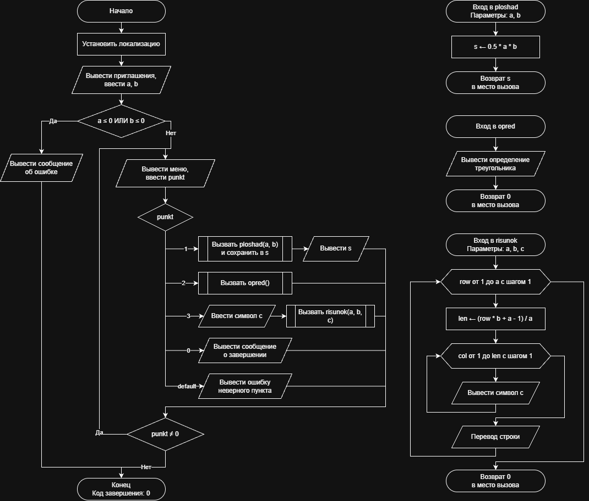

# Домашнее задание к работе 10

## Условие задачи
Составьте программу, которая для заданной пользователем фигуры, например прямоугольника (треугольника или другой фигуры см. инидивидуальное задание работы 9) предлагает меню выбора одной из операций:
1) рассчитать площадь;
2) вывести определение фигуры;
3) нарисовать фигуру.
(https://drive.google.com/file/d/16nzrf0BHD9wZWADOe2NGF4yxLYh-FOHH/view)

## 1. Алгоритм и блок-схема

### Алгоритм
1. **Начало**.
2. Инициализация окружения: установка локализации UTF-8 для корректного вывода символов.
3. Ввод исходных данных с клавиатуры:
   - Ввести катет a (высоту) и катет b (ширину основания) прямоугольного треугольника.
4. Проверка корректности входных данных:
   - Если a <= 0 или b <= 0, вывести сообщение об ошибке и завершить программу.
5. Цикл с постусловием (do-while) для работы меню:
   - Вывести пункты меню и считать выбранный номер операции punkt.
   - Многоальтернативный выбор (switch по значению punkt):
     - При punkt == 1: вызвать функцию ploshad(a, b), сохранить ответ в переменную s и вывести площадь на экран.
     - При punkt == 2: вызвать функцию opred() для вывода определения фигуры.
     - При punkt == 3: считать символ рисования c и вызвать функцию risunok(a, b, c).
     - При punkt == 0: вывести сообщение о завершении работы.
     - Иначе (default): вывести сообщение об ошибке выбора пункта меню.
6. Проверка условия цикла: если punkt != 0, повторить шаг 5.
7. **Конец**.

**Часть 2: Функция расчета площади (ploshad)**
1. **Начало функции**: получение параметров a, b.
2. Вычисление площади прямоугольного треугольника: $s = 0.5 \cdot a \cdot b$.
3. Возврат значения: передать значение s обратно в вызывающую функцию (main).
4. **Конец**.

**Часть 3: Функция вывода определения (opred)**
1. **Начало функции**.
2. Вывести текстовое определение прямоугольного треугольника на экран.
3. Возврат значения: вернуть 0 в вызывающую функцию (main).
4. **Конец**.

**Часть 4: Функция рисования фигуры (risunok)**
1. **Начало функции**: получение параметров a, b, c.
2. Внешний цикл с параметром (для row от 1 до a включительно с шагом 1):
   - Вычислить длину текущей строки: $len = (row \cdot b + a - 1) / a$.
   - Внутренний цикл с параметром (для col от 1 до len включительно с шагом 1):
     - Вывести символ c на экран.
   - Перевести курсор на новую строку.
3. Возврат значения: вернуть 0 в вызывающую функцию (main).
4. **Конец**.

### Блок-схема
 

https://github.com/stzraw/lab-10-VSTU-HW/blob/main/lab_10_schema.png

## 2. Реализация программы

```c
#include <stdio.h>
#include <locale.h>

float ploshad(float a, float b);
int opred();
int risunok(int a, int b, char c);

int main()
{
    int a, b, punkt;
    float s;
    char c;

    setlocale(LC_ALL, ".UTF8");

    printf("Введите катет a (высоту): ");
    scanf("%d", &a);
    printf("Введите катет b (ширину): ");
    scanf("%d", &b);

    if (a <= 0 || b <= 0)
    {
        printf("Ошибка: стороны должны быть положительными\n");
        return 0;
    }

    do
    {
        printf("\nМеню операций:\n");
        printf("1 - рассчитать площадь\n");
        printf("2 - вывести определение фигуры\n");
        printf("3 - нарисовать фигуру\n");
        printf("0 - выход из программы\n");
        printf("Выберите операцию: ");
        scanf("%d", &punkt);

        switch (punkt)
        {
            case 1:
                s = ploshad((float)a, (float)b);
                printf("Площадь прямоугольного треугольника: %.2f\n", s);
                break;
            case 2:
                opred();
                break;
            case 3:
                printf("Введите символ для рисования: ");
                scanf(" %c", &c);
                risunok(a, b, c);
                break;
            case 0:
                printf("Завершение работы.\n");
                break;
            default:
                printf("Ошибка: неверный пункт меню\n");
                break;
        }
    } while (punkt != 0);
    return 0;
}

float ploshad(float a, float b)
{
    float s;

    s = 0.5f * a * b;
    return s;
}

int opred()
{
    printf("Прямоугольный треугольник - это треугольник, у которого один из углов прямой (равен 90 градусам).\n");
    return 0;
}

int risunok(int a, int b, char c)
{
    int row, col, len;

    for (row = 1; row <= a; row++)
    {
        len = (row * b + a - 1) / a;
        for (col = 1; col <= len; col++)
        {
            putchar(c);
        }
        putchar('\n');
    }
    return 0;
}
```

## 3. Результаты работы программы

```
Задание 3 (ДЗ - Прямоугольный треугольник):
Введите катет a (высоту): 10
Введите катет b (ширину): 6

Меню операций:
1 - рассчитать площадь
2 - вывести определение фигуры
3 - нарисовать фигуру
0 - выход из программы
Выберите операцию: 1
Площадь прямоугольного треугольника: 30,00

Меню операций:
1 - рассчитать площадь
2 - вывести определение фигуры
3 - нарисовать фигуру
0 - выход из программы
Выберите операцию: 2
Прямоугольный треугольник - это треугольник, у которого один из углов прямой (равен 90 градусам).

Меню операций:
1 - рассчитать площадь
2 - вывести определение фигуры
3 - нарисовать фигуру
0 - выход из программы
Выберите операцию: 3
Введите символ для рисования: 0
0
00
00
000
000
0000
00000
00000
000000
000000

Меню операций:
1 - рассчитать площадь
2 - вывести определение фигуры
3 - нарисовать фигуру
0 - выход из программы
Выберите операцию: 0
Завершение работы.
```

## 4. Информация о разработчике

Быханов Александр Андреевич бИД - 262 2пг

