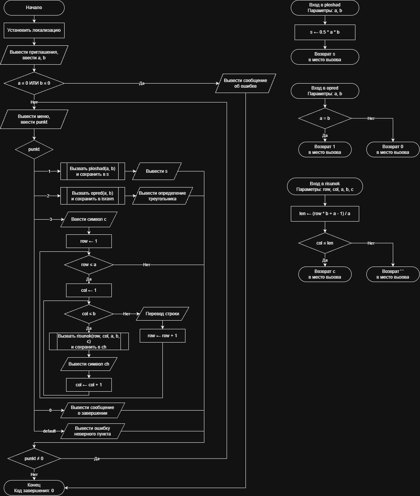

# Домашнее задание к работе 10

## Условие задачи
Составьте программу, которая для заданной пользователем фигуры, например прямоугольника (треугольника или другой фигуры см. инидивидуальное задание работы 9) предлагает меню выбора одной из операций:
1) рассчитать площадь;
2) вывести определение фигуры;
3) нарисовать фигуру.

## 1. Алгоритм и блок-схема

### Алгоритм
1. **Начало**.
2. Инициализация окружения: установка локализации UTF-8 для корректного вывода символов.
3. Ввод исходных данных с клавиатуры:
   - Ввести катет a (высоту) и катет b (ширину основания) прямоугольного треугольника.
4. Проверка корректности входных данных:
   - Если a <= 0 или b <= 0, вывести сообщение об ошибке и сразу завершить работу программы.
5. Цикл с постусловием (do-while) для работы меню:
   - Вывести пункты меню и считать выбранный номер операции punkt.
   - Многоальтернативный выбор (switch по значению punkt):
     - При punkt == 1: вызвать функцию ploshad(a, b), сохранить ответ в переменную s и вывести площадь на экран.
     - При punkt == 2: вызвать функцию opred(a, b), сохранить результат проверки в isravn и вывести определение фигуры на экран.
     - При punkt == 3: считать символ рисования c и выполнить печать фигуры во вложенных циклах (row от 1 до a, col от 1 до b), вызывая на каждом шаге функцию risunok(row, col, a, b, c) и выводя полученный символ ch.
     - При punkt == 0: вывести сообщение о завершении работы.
     - Иначе (default): вывести сообщение об ошибке выбора пункта меню.
6. Проверка условия цикла: если punkt != 0, повторить шаг 5.
7. **Конец**.

**Часть 2: Функция расчета площади (ploshad)**
1. **Начало функции**: получение параметров a, b.
2. Вычисление площади прямоугольного треугольника: $s = 0.5 \cdot a \cdot b$.
3. Возврат значения: передать значение s обратно в вызывающую функцию (main).
4. **Конец**.

**Часть 3: Функция проверки параметров для определения фигуры (opred)**
1. **Начало функции**: получение параметров a, b.
2. Если a == b, вернуть 1 (равнобедренный), иначе вернуть 0 (разносторонний) в вызывающую функцию (main).
3. **Конец**.

**Часть 4: Функция определения символа фигуры (risunok)**
1. **Начало функции**: получение параметров row, col, a, b, c.
2. Вычислить длину заполнения текущей строки: $len = (row \cdot b + a - 1) / a$.
3. Если col <= len, вернуть символ c в main, иначе вернуть пробел `' '` в main.
4. **Конец**.

### Блок-схема
 

https://github.com/stzraw/lab-10-VSTU-HW/blob/main/pravki10.drawio.png

## 2. Реализация программы

```c
#include <stdio.h>
#include <locale.h>

float ploshad(float a, float b);
int opred(int a, int b);
char risunok(int row, int col, int a, int b, char c);

int main()
{
    int a, b, punkt, row, col, isravn;
    float s;
    char c, ch;

    setlocale(LC_ALL, ".UTF8");

    printf("Введите катет a (высоту): ");
    scanf("%d", &a);
    printf("Введите катет b (ширину): ");
    scanf("%d", &b);

    if (a <= 0 || b <= 0)
    {
        printf("Ошибка: стороны должны быть положительными\n");
        return 0;
    }

    do
    {
        printf("\nМеню операций:\n");
        printf("1 - рассчитать площадь\n");
        printf("2 - вывести определение фигуры\n");
        printf("3 - нарисовать фигуру\n");
        printf("0 - выход из программы\n");
        printf("Выберите операцию: ");
        scanf("%d", &punkt);

        switch (punkt)
        {
            case 1:
                s = ploshad((float)a, (float)b);
                printf("Площадь прямоугольного треугольника: %.2f\n", s);
                break;
            case 2:
                isravn = opred(a, b);
                printf("Прямоугольный треугольник - это треугольник, у которого один из углов прямой (90 градусов).\n");
                printf("Вид по сторонам: %s\n", (isravn == 1) ? "равнобедренный (a = b)" : "разносторонний (a != b)");
                break;
            case 3:
                printf("Введите символ для рисования: ");
                scanf(" %c", &c);
                for (row = 1; row <= a; row++)
                {
                    for (col = 1; col <= b; col++)
                    {
                        ch = risunok(row, col, a, b, c);
                        putchar(ch);
                    }
                    putchar('\n');
                }
                break;
            case 0:
                printf("Завершение работы.\n");
                break;
            default:
                printf("Ошибка: неверный пункт меню\n");
                break;
        }
    } while (punkt != 0);
    return 0;
}

float ploshad(float a, float b)
{
    float s;

    s = 0.5f * a * b;
    return s;
}

int opred(int a, int b)
{
    if (a == b)
    {
        return 1;
    }
    else
    {
        return 0;
    }
}

char risunok(int row, int col, int a, int b, char c)
{
    int len;

    len = (row * b + a - 1) / a;
    if (col <= len)
    {
        return c;
    }
    else
    {
        return ' ';
    }
}
```

## 3. Результаты работы программы

```
Введите катет a (высоту): 10
Введите катет b (ширину): 6

Меню операций:
1 - рассчитать площадь
2 - вывести определение фигуры
3 - нарисовать фигуру
0 - выход из программы
Выберите операцию: 1
Площадь прямоугольного треугольника: 30,00

Меню операций:
1 - рассчитать площадь
2 - вывести определение фигуры
3 - нарисовать фигуру
0 - выход из программы
Выберите операцию: 2
Прямоугольный треугольник - это треугольник, у которого один из углов прямой (равен 90 градусам).

Меню операций:
1 - рассчитать площадь
2 - вывести определение фигуры
3 - нарисовать фигуру
0 - выход из программы
Выберите операцию: 3
Введите символ для рисования: 0
0
00
00
000
000
0000
00000
00000
000000
000000

Меню операций:
1 - рассчитать площадь
2 - вывести определение фигуры
3 - нарисовать фигуру
0 - выход из программы
Выберите операцию: 0
Завершение работы.
```

## 4. Информация о разработчике

Быханов Александр Андреевич бИД - 262 2пг

